# 칠리 콘 카나지 (PSP) 비공식 한글패치

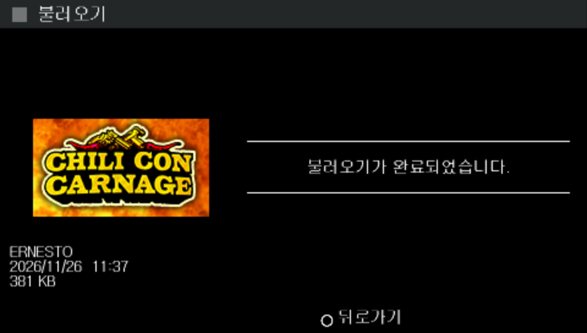

PSP 북미판 **Chili Con Carnage (칠리 콘 카나지, ULUS-10216)** 비공식 한국어 패치입니다. 이 저장소에는 제작 도구와 기술 문서만 있고, 패치 파일(xdelta)은 [Releases](../../releases)에서 받을 수 있습니다. 게임 원본·영어 원문·번역 대본은 포함하지 않습니다.

## 적용 방법

1. 아래 해시와 일치하는 **원본 `.iso`** 를 준비합니다. (CSO·CHD 등으로 변환한 이미지에는 적용할 수 없습니다.)
   - PowerShell: `Get-FileHash -Algorithm MD5 -LiteralPath '.\Chili Con Carnage (USA).iso'`
2. xdeltaUI 같은 도구로 원본 `.iso` 에 `ChiliConCarnage_KR_v1.3.xdelta` 를 적용합니다. (Patch = xdelta, Source File = 원본 ISO, Output File = 새 파일명)
   - 명령줄: `xdelta3 -d -s "Chili Con Carnage (USA).iso" ChiliConCarnage_KR_v1.3.xdelta "Chili Con Carnage (Korean).iso"`
3. 만들어진 ISO를 PPSSPP 또는 커스텀 펌웨어(PSP·PS Vita Adrenaline 등)에서 실행합니다.

| 항목 | 값 |
| --- | --- |
| 원본 ISO 크기 | 797,081,600 바이트 |
| 원본 ISO MD5 | `4d756980b0c67b5bb2faa1d15aa3f3c7` |
| 원본 ISO SHA-256 | `1808b0f3e960b85e17a8510486a866c490a0afc141268ad58ff60bdc1ca02a45` |
| xdelta SHA-256 | `0fe3782371bd8d14742b7def7a23a3d9e38f7c570ca7844bb207986b2be71620` |
| 결과 ISO 크기 | 797,372,416 바이트 |
| 결과 ISO MD5 | `e252d5cd7b8f6f3aee2cba30792cc31f` |
| 결과 ISO SHA-256 | `30870b3222a71aba0e1ddde36e1f501f1540b996311a0126e7fa4c146f54dfef` |

## 주의
- 북미판(ULUS-10216) 원본 전용입니다.
- 실행 파일(EBOOT)은 건드리지 않고 데이터 파일만 바꿨습니다.
- 원본에서 만든 **상태저장(세이브 스테이트)** 은 불러오지 마세요. 일반 세이브 데이터는 그대로 쓸 수 있습니다.
- xdelta는 2차 압축을 쓰지 않은 형식입니다(약 0.3MB).

## 한글화 내용
- 메뉴 319, HUD·콤보 기술 이름 288, 도움말 72, 로딩 화면·도전 미션 설명 122항목
- 스토리 컷신 자막 8편과 엔딩, 미션 목표 안내 21개 파일, 게임 중 대사 18개 파일, 도전 모드 문구
- 약 960줄 전체 직접 번역 (기계 번역 사용하지 않음)
- 그림 글자 한글화 (텍스처 전수 검사 결과 영어 글자가 있던 이미지 전부)
  - 부팅 저작권 화면: 원본 6줄의 위치·글자 높이(10px)·줄 간격(17px)·가운데 정렬·외곽선과 그림자를 측정해 그대로 맞춤
  - 트로피 룸 콘셉트 아트 4장: 지도 설명 라벨 8개, 스토리보드 대사 12칸 (원본 글자 자리를 측정해 지우고 같은 위치에 다시 씀)
- 게임 글꼴(본문+외곽선 2종)에 한글 추가
  - 원본의 굵고 기울어진 글꼴과 비슷한 나눔스퀘어네오 Bold에 기울임을 줘서 그렸습니다.
  - 그림 속 아주 작은 글씨(콘셉트 아트)는 갈무리 글꼴로 썼습니다.
  - 작은 확인창에서도 쌍자음(ㄲ·ㄸ·ㅃ·ㅆ·ㅉ)이 뭉개지지 않도록 해당 글자는 가는 굵기로 넓게 그렸습니다.

## 그대로 둔 것
- 타이틀 로고·게임 로고 그림, 회사 로고, 동영상 속 그림 글자(신문 등), 스토리보드 그림 속 소품 글씨(CONTRACT)
- 레벨 배경 안의 간판 등 소품 글씨(고유명사)
- 영어 음성
- 실행 파일 안의 문자열(EBOOT 암호화)

## 검증 범위
PPSSPP에서 부팅 저작권 화면, 트로피 룸 콘셉트 아트, 타이틀, 프로필 생성·불러오기, 메인 메뉴, 이야기 선택, 미션 브리핑, 게임 플레이 HUD, 일시정지·종료 확인창, 미션 완료·통계, 도전 미션 해금·스타일 도전 목록·완료 화면을 실제로 확인했습니다. 번역문에 영어가 남지 않았음을 검사했습니다(쓰이지 않는 빈 슬롯 제외). 그림은 독립 텍스처 59개와, 메뉴·HUD·레벨 실행 중 메모리에 올라온 텍스처 약 520개를 모두 꺼내 확인했습니다. 후반 스토리와 멀티플레이, 실기 PSP는 직접 확인하지 못했습니다. 문제를 발견하면 Issues로 알려 주세요.

## 스크린샷

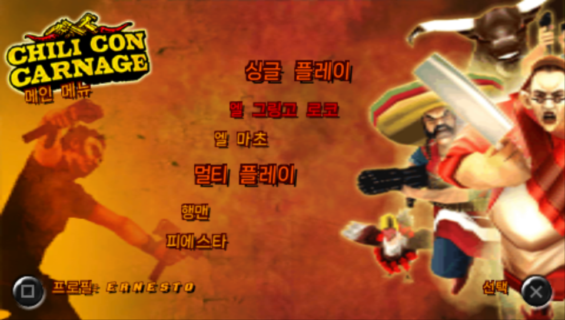 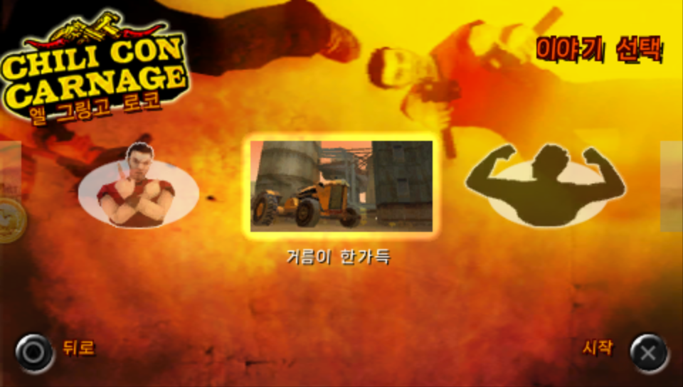
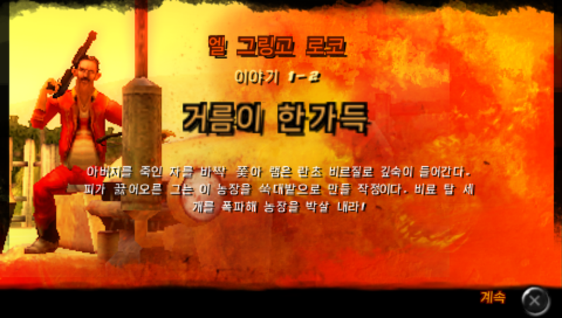 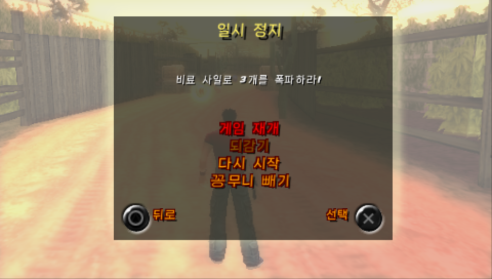
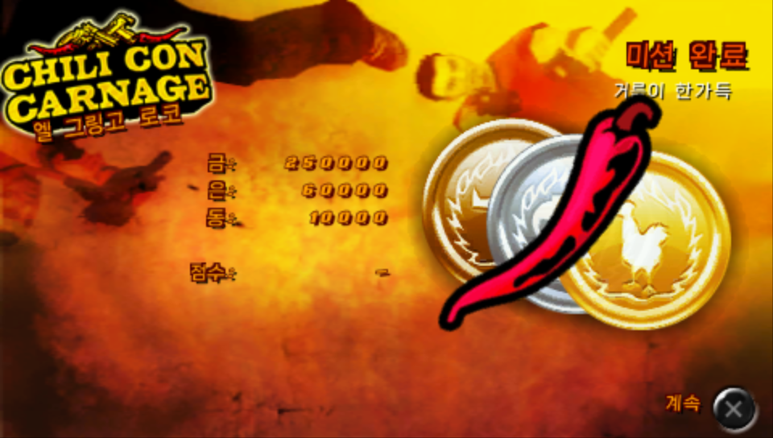 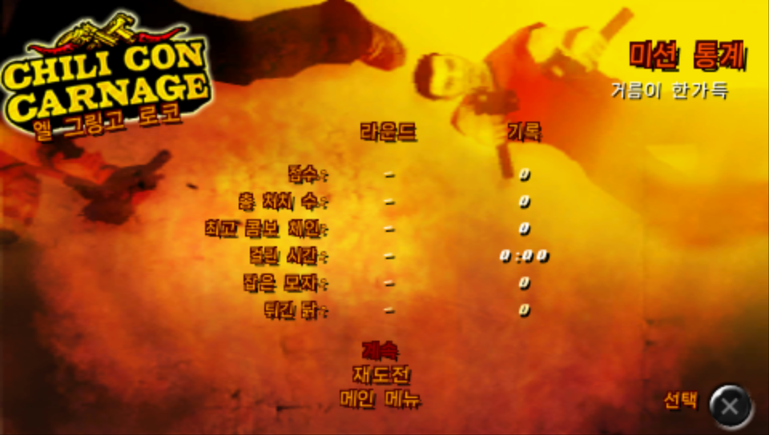
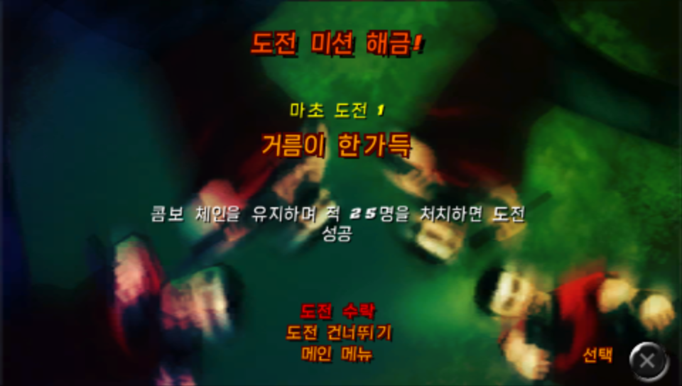 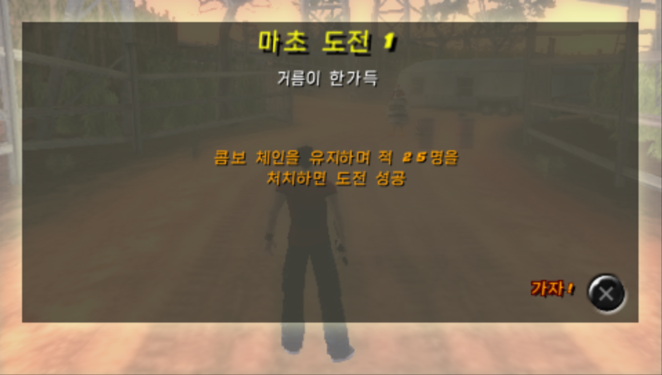
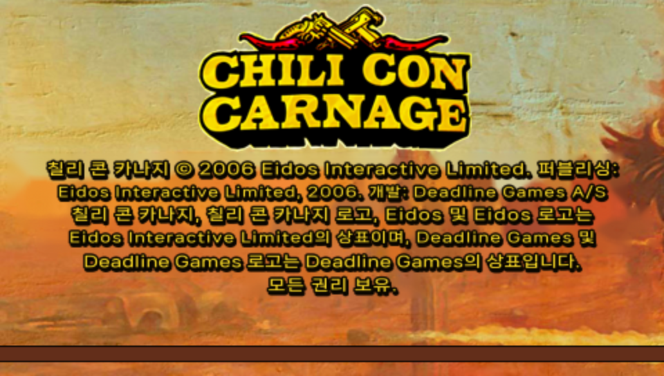 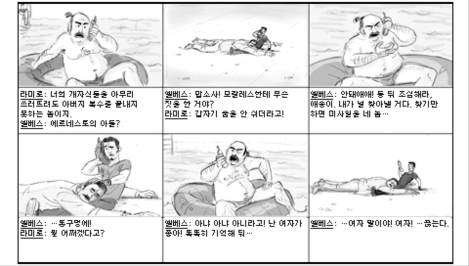

## 문서
- [CHANGELOG.md](CHANGELOG.md) — 변경 기록
- [docs/TECHNICAL.md](docs/TECHNICAL.md) — 파일 형식과 한글화 방법
- [docs/BUILD.md](docs/BUILD.md) — 직접 빌드하는 방법
- [docs/TRANSLATION_GUIDE.md](docs/TRANSLATION_GUIDE.md) — 번역 지침
- [docs/FONT_CREDITS.md](docs/FONT_CREDITS.md) — 글꼴
- [RIGHTS.md](RIGHTS.md) — 권리 및 외부 자료
